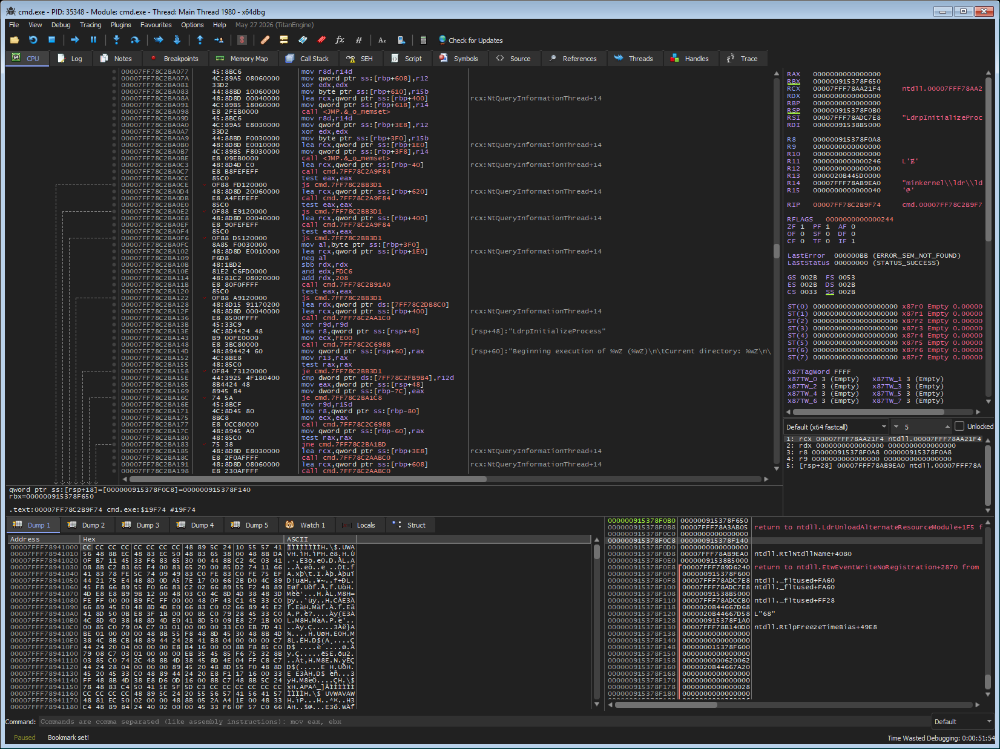

[](https://www.apache.org/licenses/LICENSE-2.0)
[](https://github.com/starsong-consulting/GhydraMCP/releases)
[](https://github.com/starsong-consulting/GhydraMCP/blob/main/GHIDRA_HTTP_API.md)
[](https://github.com/starsong-consulting/GhydraMCP/stargazers)
[](https://github.com/starsong-consulting/GhydraMCP/network/members)
[](https://github.com/starsong-consulting/GhydraMCP/graphs/contributors)
[](https://github.com/starsong-consulting/GhydraMCP/actions/workflows/build.yml)

# GhydraMCP

**Static analysis in Ghidra, dynamic analysis in x64dbg, and a second opinion from the Kuna
decompiler — over MCP or from the command line.**


## Overview

Three surfaces, one assistant:

| | What it is | What it gives the assistant |
| --- | --- | --- |
| **Ghidra** | The plugin, inside the CodeBrowser | 96 tools over the program: functions, data, structures, xrefs, the CFG, the decompiler, capability negotiation and triage, background tasks |
| **x64dbg** | A plugin that lives inside the debugger | The debugger's own 80 tools over the live process: registers, memory, breakpoints, stepping |
| **Kuna** | A separate decompiler CLI | A second opinion on the same binary, and the recovered C as MCP resources |

The bridge exposes **115 tools** in total: the 96 above, 6 over x64dbg (the pass-through that reaches
the debugger's own 80), and 13 for the Kuna exports.

The two debugger sides share one model of addresses, so a static address from Ghidra can be turned
into a live one for x64dbg — and a breakpoint the assistant sets lands on the instruction the
static analysis was talking about.

Neither of the two new integrations changes the Ghidra REST API: `API_VERSION` is still **3000**,
and the plugin gains no endpoint. They are local — a plugin on this machine, and a CLI on this
machine — and they work with any Ghidra version.

The components:

1. **Ghidra plugin** — exposes Ghidra over a HATEOAS REST API
2. **CLI tool (`ghydra`)** — a standalone terminal client; human-readable tables, plus `--json`
   for scripting and AI tool use
3. **MCP bridge** — a Python script that translates MCP requests into API calls
4. **Multiple instances** — connect several Ghidra windows to work on different binaries at once

> **Note:** The MCP bridge (`bridge_mcp_hydra.py`) is being deprecated in favor of the CLI tool
> (`ghydra`). The CLI provides the same capabilities with better output formatting, `--json` mode
> for scripting and AI tool use, and doesn't require an MCP-capable client. The bridge will
> continue to work but is no longer the recommended integration path. The two local integrations
> below are available through both, and the MCP resources are MCP-only by nature.

Through it, an assistant can:

- Decompile and analyze binary code, with a few output formats
- Map program structure, function relationships, and data types
- Run binary analysis (cross-references, call graphs, data flow)
- Edit the analysis (rename, annotate, create/delete/modify data)
- Read and write memory
- Follow HATEOAS links between resources
- Set breakpoints in a live debugger, from an address Ghidra found
- Read the recovered C of a whole binary as MCP resources

GhydraMCP started as a fork of [GhidraMCP by Laurie Wired](https://github.com/LaurieWired/GhidraMCP/) and added multi-instance support, data manipulation, and a HATEOAS REST API.

## What's new

### Where this stands against the REA

The REA's tool catalogue was read off its own server, not off a document: 139 tools in the
installed version. The comparison by capability covers what is implemented, what is not, and
the four native gaps worth closing.

**Those four are closed now**, each on the three surfaces at once:

| What an agent asks | REST API | Bridge tool | CLI |
| --- | --- | --- | --- |
| decompile a list of functions | `POST /functions/decompile-batch` | `functions_batch_decompile` | `ghydra functions decompile-batch --targets '["main","0x401000"]'` |
| what refers to this *name* | `GET /xrefs/to-name/{name}` | `xrefs_find_by_name` | `ghydra xrefs find-by-name strlen` |
| what is at this address | `GET /inspect/address/{address}` | `inspect_address` | `ghydra inspect-address 0x140001008` |
| how does A reach B | `GET /analysis/call-path?from=&to=` | `analysis_trace_call_path` | `ghydra analysis trace-call-path --from main --to strcmp` |

A batch reports each target separately — one name that resolves to nothing does not cost the other
nine. An address answer holds the symbol, the containing function, the data, the instruction, both
comments and the references on both sides, gathered in one traversal. A call path is the shortest
one Ghidra knows about, and when there is none it says how many functions it looked at.

Four more came out of the same comparison — the composed calls the REA has:

| What an agent asks | Bridge tool | CLI |
| --- | --- | --- |
| who calls this function | `analysis_callers` | `ghydra analysis callers 0x401000` |
| what does this function call | `analysis_callees` | `ghydra analysis callees 0x401000` |
| everything about this function | `functions_analyze` | `ghydra functions analyze --address 0x401000` |
| what is this binary | `programs_overview` | `ghydra analysis overview` |

The first two were already in the REST API since 3.0.0 — the bridge and the CLI simply never
exposed them. The other two are compositions of what was already there: one call that gathers the
function, its decompilation, its callers, its callees and its references, and one that gathers the
program, its layout, its counts and its imports.

### The headless GhydraMCP

The API can run without a window. `ghydra headless start <binary>` imports and analyses the binary
in a headless Ghidra run and serves the same REST API from it — the same twenty-one resources, the
same decompiler service, the same middleware. `ghydra report build <binary>` puts Ghidra and Kuna
side by side in one report and writes the annotations for the debugger, so a human opens it and
finds the interesting functions already marked. Full reference:
[GHYDRA_HEADLESS.md](GHYDRA_HEADLESS.md).

### The doctor

Every tool here has a way to fail that is discovered late: the installation is somewhere else than
the environment says, the JDK is older than the Ghidra asks for, the extension was built for
another version, the port is taken. `ghydra doctor` looks at all of it at once and says what is
wrong — with the command that solves it next to the problem:

```
ghydra doctor
```


### The evidence ledger and the sessions

A finding — a function that matters, a string that is a key — used to live in the analyst's head
and die with the session. `ghydra evidence` gives every finding an ID that never changes and is
never given out twice, and exports the whole lot as a bundle: a document to read and one to read
with a program. `ghydra session` is the other half: a named working context — the binary, the
port that serves it, the state — that survives the shell that opened it.

```
ghydra evidence add --kind function --address 0x140001000 \
    --name decrypt_blob --note "the key comes from the serial" --tags crypto
ghydra evidence list --tag crypto
ghydra evidence export --output out

ghydra session open C:\bin\cmd.exe --name cmd
ghydra session list
ghydra session close s-3f9a21c4
```

### The x64dbg integration

The assistant can now drive a live debugger, with the static analysis and the dynamic one sharing
one address model. Six tools, an address translation that works on a real process, and a failure
taxonomy that tells an agent whether the debugger already acted. Full reference:
[GHYDRA_X64DBG.md](GHYDRA_X64DBG.md).

### The Kuna exports are MCP resources

A Kuna export — the recovered C, the disassembly and an index of every function — used to be
reachable only through an in-memory job id that died with the bridge. It is now exposed as MCP
resources, addressed by a digest that outlives the process:

```
kuna://exports                              the manifest of every export on disk
kuna://export/{digest}/index.jsonl          the function index
kuna://export/{digest}/{function}.c         one function, as C
kuna://export/{digest}/{function}.asm       one function, as assembly
kuna://export/{digest}/README.md            what the export is
```

That is the retrieval loop with **exact** addressing: list the exports, read the index, read one
function. A corpus with an exact index does not need embeddings — they would retrieve the wrong
function more often than the right one. Full reference: [GHYDRA_KUNA.md](GHYDRA_KUNA.md).

### The resources a client can actually read

The resources of the instance carried a relative URI (`/instance/{port}/...`), and the protocol
types the URI of a read as a URL: the server refused it before the resource was even looked up.
No client could name them, so no client could read them. They carry the `ghidra://` scheme now:

```
ghidra://instance/{port}                                     the instance and its program
ghidra://instance/{port}/function/decompile/address/{address}  the C of one function
ghidra://instance/{port}/function/disassembly/address/{address} the listing of one function
ghidra://instance/{port}/function/info/name/{name}             what a function is
```

The bridge answers in **text**, because that is what an agent reads. A program that wants the
envelope itself asks for it: `GHYDRA_MCP_OUTPUT=json` hands the raw response as one JSON
document.


### 3.0.0

`API_VERSION` is **3000** — see [GHIDRA_HTTP_API.md](GHIDRA_HTTP_API.md) for the full reference
and [CHANGELOG.md](CHANGELOG.md) for the full list.

**Breaking — fully-qualified symbol names.** Functions, symbols, data labels, variables, and
xrefs now use the FQN (e.g. `FOM::SharedMemory::ReadUInt`; global-namespace members are
unprefixed) for lookup, filtering, and output. A bare name resolves in the global namespace
only. Renaming to `A::B::name` moves a symbol into that namespace, creating it if needed; a
leading `::` or `Global::` targets the global namespace. The separate `namespace` field is gone
from function and symbol responses.

**New**

- **Raw image rendering** — `POST /raw-image/define`, the `raw_image_define` MCP tool, and
  `ghydra raw-image define` mark a memory region as image data so a captured framebuffer renders
  inline in the Listing. 9 pixel formats plus little/big endian. Paired with
  `raw_image_cleanup` / `ghydra raw-image cleanup`, which removes one image or sweeps the whole
  program atomically.
- **CFG and p-code introspection** — `GET /functions/{address}/cfg` and `/pcode`,
  `functions_get_cfg` / `functions_get_pcode`, and `ghydra functions get-cfg` / `get-pcode`.
- **Script execution** — `POST /scripts/run` runs an existing GhidraScript or ad-hoc source and
  returns its output. Disabled unless Ghidra is started with `-Dghidra.dev.allowScripts=true`
  (or `GHYDRA_ALLOW_SCRIPTS=1`), because it is arbitrary code execution.
- **Program save and shutdown** — `POST /program/save` and a dev-only `POST /dev/shutdown`
  (enable with `-Dghidra.dev.allowShutdown=true` or `GHYDRA_DEV_SHUTDOWN=1`) so the
  build/deploy/restart loop can be automated.
- **Scalar search** — `GET /scalars` finds constant values in instructions, like Ghidra's
  "Search For Scalars".
- **Variable editing from the CLI** — `ghydra functions set-variable` renames or retypes a
  function local.

**Changed**

- The plugin was migrated from the raw JDK `HttpServer` to **Javalin** with a
  service/DTO/resource layout, and now builds against the Ghidra 12.x series.
- **Write failures return `409 TRANSACTION_FAILED`** instead of `500` — almost always a
  read-only or locked program. This affects every mutating endpoint.

**Removed**

- `ghydra functions update-variable`, a duplicate of `functions set-variable` with different
  flags. Use `set-variable`; the `functions_update_variable` MCP tool and the underlying
  `PATCH /functions/{address}/variables/{variable_name}` endpoint are unchanged.

## The headless GhydraMCP

The plugin serves the REST API from a window a human is looking at. A headless Ghidra run serves
the very same API with nobody watching: the binary is imported, analysed, and the API answers for
that analysis.

It is not a second implementation. The headless run starts the same server, registers the same
twenty-one resources and uses the same decompiler service. What is behind them is what differs:
one fixed program and one fixed project, instead of a ProgramManager, a tool and a UI.

```
ghydra headless start C:\bin\cmd.exe      # analyse and serve, on port 8192
ghydra headless status                    # what is running
ghydra headless stop                      # end it; the analysis is saved first
```

The run outlives the command that started it — the state lives under `~/.ghidra`, so the MCP
bridge finds it on its own, exactly like a CodeBrowser instance.

### The report, and the annotations for the debugger

```
ghydra report build C:\bin\cmd.exe --output out
```

Three files come out: the report to read (`cmd-report.md`), the report to read with a program
(`cmd-report.json`) and the annotations for the debugger (`cmd-x64dbg.json`).

Ghidra and Kuna are put side by side — the program, its functions, its imports, its strings and its
segments, next to the C that Kuna recovered — and the two are matched **by address**, because both
tools read the same binary at the same addresses.

```
ghydra x64dbg annotate out\cmd-x64dbg.json --bookmarks
```

Every interesting function becomes a comment — the signature, the size, what Kuna called it — and a
bookmark. The human opens the debugger and finds them marked.



The dynamic half is `ghydra x64dbg report`: the state, the registers, the modules with their bases,
the breakpoints, the disassembly at the instruction pointer, the call stack and the memory map.

### The limits of a headless run

The endpoints that need the GUI's cursor — `/address` and `/function` — answer `503` in a headless
run. There is no cursor without a window. Every other endpoint behaves the same in both.

The debugger is a different matter: the x64dbg plugin drives it without a human, but the debugger
is a program with a window, and there is no build of it that runs without one.

# The x64dbg integration

The [x64dbg MCP server](https://github.com/duty1g/x64dbg-mcp-server) is a plugin that lives inside
the debugger. It answers JSON-RPC 2.0 requests POSTed to `/` with a bearer token, and it exposes
80 tools over the running debuggee.

## How the two sides line up

Ghidra works on the image as it sits in the file, at the image base. x64dbg works on the live
process, where the loader put the module. The difference is a constant:

```
runtime = static − image_base + module_base
```

The image base comes from Ghidra's `/program` endpoint, the module base from the plugin's
`ListModules`. The two binaries are matched by full path first and by file name second, because
the two sides can disagree about the directory without disagreeing about the file.

`x64dbg_breakpoint_at` takes the **static** address — the one Ghidra shows — and translates it.
The static address on its own is not mapped in the live process: it does not disassemble there.

## The tools

Six, not eighty. Exposing all of them would put 165 tools in one agent's tool list, which
measurably degrades tool selection. What is exposed is the catalogue, a pass-through, and four
workflow tools that carry the address model:

| Tool | What it does |
| --- | --- |
| `x64dbg_status` | Whether the server answered, what it has, and which modules are loaded |
| `x64dbg_tools` | The catalogue: name, description, input schema, and the read-only hint |
| `x64dbg_call` | Any plugin tool by name |
| `x64dbg_target` | The two sides of the address model: the image base and the module base |
| `x64dbg_breakpoint_at` | A Ghidra address becomes a live breakpoint |
| `x64dbg_go_to` | A Ghidra address becomes the instruction pointer |

The same six exist on the command line:

```bash
# Is the debugger there, and what is it looking at
ghydra x64dbg status

# The plugin's catalogue: eighty tools, with their schemas
ghydra x64dbg tools

# Call any of them by name
ghydra x64dbg call GetAllRegisters
ghydra x64dbg call SetBreakpoint --arg target=0x7FF7A1234000
ghydra x64dbg call ReadMemory --json-args '{"address": "0x7FF7A1234000", "size": 64}'

# The tools that block need more time than the default 30 seconds
ghydra x64dbg call WaitForEvent --json-args '{"timeoutMs": 60000}' --timeout 90

# How the Ghidra program and the x64dbg session line up
ghydra x64dbg target

# A breakpoint on a Ghidra address, translated into the runtime address
ghydra x64dbg breakpoint 0x140001234

# Move the instruction pointer there
ghydra x64dbg go-to 0x140001234
```

## The arguments travel as one piece of text

`x64dbg_call` takes the plugin's arguments in `tool_arguments`, as **JSON text**:

```json
{"tool": "Disassemble", "tool_arguments": "{\"address\": \"0x7FF7A1234000\", \"count\": 3}"}
```

That is deliberate. A client that re-encodes the container the MCP protocol uses for a tool's
parameters flattens what is nested in it: every value of a nested object arrives as a string.
Measured on this desktop, where an integer `count` arrived as `"3"` — and the plugin, which
ignores a parameter it cannot read, answered with its default count instead of the one that was
asked for, and the call looked like it had worked. The text is the form nothing gets in the way
of. An object is still accepted, and its types are put back from the plugin's own input schema
before the call.

## Failures carry a code

The bridge and the CLI carry the same ten codes, so an agent can branch on the reason instead of
reading prose:

| Code | What it means |
| --- | --- |
| `X64DBG_ERROR` | The generic fallback |
| `X64DBG_DISABLED` | No token, so there is no way to talk to the server: the scan is not even tried |
| `X64DBG_MISSING` | Nothing answered on the port, and the request never left |
| `X64DBG_TIMEOUT` | The server did not answer in time |
| `X64DBG_UNCERTAIN` | The request was sent but the answer was lost: the debugger may already have acted |
| `X64DBG_UNAUTHORIZED` | The bearer token did not match |
| `X64DBG_NO_SESSION` | No debug session in x64dbg |
| `X64DBG_NO_TOOL` | The plugin has no tool with that name |
| `X64DBG_BAD_ARGS` | The tool rejected the arguments |
| `X64DBG_NO_MATCH` | The binary does not match any loaded module |

`X64DBG_UNCERTAIN` exists because "the request never left" and "the answer was lost on the way
back" are not the same failure, and an agent that cannot tell them apart retries a call that
may already have changed the debuggee. A request is only sent again when it is safe to send
again, and the plugin marks every tool with `annotations.readOnlyHint`.

## Configuring it

The token is the one thing that has to be found somewhere: the plugin writes it to its own
`mcp_config.json`, next to `x64dbg.exe`. Point at the installation and it is read from there.

```json
{
  "x64dbg": {
    "path": "C:/tools/x64dbg"
  }
}
```

The environment carries the same, and the path too: `GHYDRA_X64DBG_HOST`, `GHYDRA_X64DBG_PORT`,
`GHYDRA_X64DBG_TOKEN` and `GHYDRA_X64DBG_PATH`. The config file wins over the environment, as
everywhere else. The path is worth having in the environment because the token is the one thing
that cannot be guessed: `GHYDRA_X64DBG_PATH` is enough to make the integration work without
editing a configuration file at all.

The plugin's own file fills the blanks and only the blanks. It says which address the plugin
listens on, and that is what is used when nothing else says so — but a host or a port that came
from the config file or from the environment is a decision the user made, and the plugin's file
does not get to overrule it.

## Verified against the real plugin

Not only against the fake one the test suite uses. With `cmd.exe` loaded under the debugger, the
token and the port were read from the plugin's own `mcp_config.json`, the server reported its 80
tools and the five loaded modules, the static entry point of `cmd.exe` translated to the address
the loader had given the module and disassembled to the real entry stub (the static address on
its own is not mapped in the live process), and the breakpoint set at that translated address was
listed by the debugger as `cmd.exe!entry breakpoint` — resolved by name.

## The limits

- The plugin has to be loaded and the debugger has to be running.
- The tools that block (`run`, `WaitForEvent`, `WaitForPause`) need a `timeout` longer than their
  own, since the default read timeout is 30 seconds.
- `x64dbg_go_to` moves the instruction pointer, so the debuggee has to be paused.

# The Kuna decompiler

[Kuna](https://github.com/Noelo-Lab/kuna) is a standalone decompiler CLI. The bridge and the CLI
drive it as a subprocess, so it touches neither the REST API nor `API_VERSION`, and it works with
any Ghidra version.

It is **opt-in**, because it is an elevation of privilege: the bridge normally only speaks HTTP,
and this lets it run a program on the host. Enable it with `GHYDRA_KUNA=1` or with
`"kuna": {"enabled": true}` in `~/.ghydra/config.json`. The config file wins: an explicit
`enabled: false` keeps it off even with the environment variable set.

```bash
# Size up a binary: function count, entry point, reachability
ghydra kuna summary ./challenge.exe

# Decompile one function
ghydra kuna decompile ./challenge.exe main

# Find crypto constants and the functions that use them
ghydra kuna crypto ./challenge.exe --algorithm AES

# Analyse once, write the recovered C, the disassembly and an index to disk
ghydra kuna export ./challenge.exe -o ./challenge.kuna

# Then read from the export
ghydra kuna export-read ./challenge.kuna main
ghydra kuna export-read ./challenge.kuna main --artifact asm
```

## The export, and the cost of it

Kuna loads and analyses the whole image on every invocation — measured with Kuna 1.988: 20 s for
a 44 MB binary, 0.5 s for a 332 KB one. The cost is the analysis, not the command, so the export
flow is the main path: analyse once into `~/.ghydra/kuna/<digest of path+mtime>/`, then read the
C, the disassembly and `index.jsonl` from disk.

A complete export is reused rather than re-analysed. Measured: re-reading the export of a 332 KB
binary takes 21 ms against the 2 750 ms of the export itself; for a 44 MB binary it is 152 ms
against the 154 s of the export. The re-read is not quite free either — it reads the index, which
holds one record per function.

The export is addressed by its digest, not by the job. The digest is 12 hex characters, survives a
restart of the bridge, and is what `kuna_export_read`, the `kuna://export/<digest>/` resources and
`ghydra kuna status` all use. The job registry lives in the bridge process, so a job started by
one bridge is invisible to another and does not survive a restart — which is why the digest
exists.

Two rules keep a stale export from answering for the wrong thing:

- **A subset is not the whole binary.** The digest is keyed by the path and the modification time,
  *not* by the filter, so the same directory serves a filtered export and an unfiltered one. The
  sidecar records the filter, and an unfiltered request against a filtered export is analysed
  again.
- **A directory the caller named has no provenance of its own.** The digest directory carries the
  provenance in its name; a directory given with `-o` does not. The sidecar records the
  modification time as well as the binary, so another binary — or the same path rebuilt — is
  analysed again instead of answered with stale artifacts.

Full reference, including the fourteen error codes and the export readers:
[GHYDRA_KUNA.md](GHYDRA_KUNA.md).

# The Ghidra plugin

## Program analysis

- **Decompilation**:
  - Convert binary functions to readable C code — Ghidra's C-like pseudocode, produced with the
    decompiler options of the program being analyzed (there is no target-language selector: the
    plugin returns the decompiler's C directly)

- **Static analysis**:
  - Cross-reference analysis (find callers and callees)
  - Call graph generation and traversal
  - Data flow analysis with variable tracking
  - Type propagation and reconstruction
  - Function relationship mapping
  - Control-flow graph: the basic blocks of a function and the edges between them
  - P-code: the decompiler's own intermediate representation
  - Scalar search: the constant values in the instructions

- **Memory**:
  - Direct memory reading with hex and raw byte representation
  - Address space navigation and mapping
  - Memory segment analysis

- **Symbols**:
  - View and analyze imports and exports
  - Identify library functions and dependencies
  - Symbol table exploration and manipulation
  - Namespace hierarchy visualization
  - Fully-qualified names: functions, symbols, data, variables, and xrefs are returned and matched by their namespace-qualified name (e.g. `MyClass::method`; global-namespace members are unprefixed). A bare name resolves in the global namespace only, and renaming with `::` moves a symbol into that namespace (created if absent)

## Interactive reverse engineering

- **Code understanding**:
  - Explore function code in context
  - Analyze data structures and complex types
  - View disassembly with linking to decompiled code
  - Examine function prototypes and signatures

- **Annotation**:
  - Rename functions, variables, and data
  - Add multiple comment types (EOL, plate, pre/post)
  - Create and modify data types
  - Set and update function signatures and prototypes

- **In the live debugger**:
  - Set a breakpoint on an address Ghidra found, translated to where the loader put the module
  - Read registers, memory and stack frames from the running process
  - Move the instruction pointer to a Ghidra address

## Data manipulation

- **Data**:
  - Create new data items with specified types
  - Delete existing data items
  - Rename data items
  - Set and update data types for existing items
  - Combined rename and retype operations
  - Type definition management

- **Functions**:
  - Rename functions
  - Update function signatures with parameter information
  - Modify local variable names and types
  - Set function return types

## Multiple instances and projects

- **Instances**:
  - Run multiple Ghidra instances simultaneously on ports 8192-8447 (256 port range)
  - Analyze different binaries in parallel
  - Connect to specific instances using port numbers
  - Auto-discovery of running Ghidra instances
  - Instance metadata with project and file information
  - Plugin version and API checking for compatibility

- **Projects**:
  - Get current project information (name, location, file counts)
  - List all files in a project with filtering
  - Open project files in new CodeBrowser windows
  - Navigate project folder hierarchy
  - Automatic instance registration when opening new programs

## Navigation and discovery

- List and search functions, classes, and namespaces
- View memory segments and layout
- Search by name, pattern, or signature
- Resource discovery through HATEOAS links
- Pagination for handling large result sets
- Filtering capabilities across all resources

# Installation

## Prerequisites

- **Ghidra** 11.x or 12.x (the plugin is built against both)
- **Python** 3.11 or later
- **uv** (recommended) or pip
- **Java** 21 or later, to build the plugin from source

## Ghidra

1. Download the latest release from the releases page. Each release ships an artifact per Ghidra
   series — `Ghydra-v3.0.0-...-ghidra12.2.zip` for Ghidra 12.2 and `...-ghidra11.4.3.zip` for
   Ghidra 11.4.3 (plus a `Ghydra-Complete-...` variant that also carries the bridge script). The
   `ghidra<version>` suffix must match your install **exactly**: it is the `ghidraVersion` the
   extension declares, and Ghidra refuses to load an extension whose version does not match the
   running install — a mismatch is a failed install, not a warning.
2. Extract it
3. In Ghidra: `File` → `Install Extensions` → the `+` icon → select the zip → `OK`
4. Restart Ghidra
5. In Ghidra: `File` → `Configure` → `Developer` → tick **Ghidra** → `OK`

The plugin is declared in Ghidra's `Developer` package, so the install makes Ghidra *discover* it,
not enable it. Without step 5 `GhydraPlugin` is never constructed, no HTTP port binds, and
neither the CLI nor the bridge can reach the program.

The first CodeBrowser binds port 8192; a second one binds 8193, and so on.

For a later update, swap `lib/Ghydra.jar` in the installed extension and restart Ghidra — there
is no need to reinstall the whole thing.

## CLI Tool

```bash
# Install
pip install -e .

# or, with uv — it does not create an environment on its own, so make one first
uv venv && uv pip install -e .
```

```bash
# List running Ghidra instances
ghydra instances list

# Decompile a function
ghydra functions decompile --name main

# List the strings in the program
ghydra data list-strings

# Read memory as a hex dump
ghydra memory read --address 0x401000 --length 64

# JSON output for scripting and piping
ghydra --json functions decompile --name main
```

The `--json` flag goes **before** the subcommand. The config precedence is CLI flag >
`GHYDRA_HOST`/`GHYDRA_PORT` > `~/.ghydra/config.json` > defaults (`localhost:8192`, timeout 900).

### Installing on Linux and NixOS

```bash
# uv, with its own environment (recommended)
uv tool install .

# a plain virtualenv
python3 -m venv .venv && . .venv/bin/activate && pip install -e .
```

On NixOS, `uv` has no interpreter of its own inside a `nix-shell`, so point it at the shell's
`python3`:

```bash
nix-shell -p python3 -p uv
```

...and inside that shell:

```bash
uv tool install --python python3 .
```

`--python python3` tells `uv` to use the nix-provided interpreter instead of
downloading one.

The bridge resolves the Kuna binary from `PATH` or from the `kuna.path` key in
`~/.ghydra/config.json`, which is the way to point at a binary installed outside the
default profile. See [GHYDRA_KUNA.md](GHYDRA_KUNA.md).

Timeout defaults are intentionally high for large binaries:
- CLI/bridge HTTP timeout default: `900s` (`GHYDRA_TIMEOUT`)
- Decompilation timeout default: `1200s` (`GHYDRA_DECOMP_TIMEOUT`)
- Incomplete decompilation responses include retry guidance (`retry_recommended`, `suggested_timeout_seconds`)

The bridge answers in **text**, because a table is what an agent reads best. A machine that
parses the answer can ask for the raw envelope instead with `GHYDRA_MCP_OUTPUT=json` — the
response then arrives as one JSON document, with the same fields the text is built from.

## MCP Clients

Any MCP client works. The bridge is a stdio server:

```json
{
  "mcpServers": {
    "ghydra": {
      "command": "uv",
      "args": ["run", "/ABSOLUTE_PATH_TO/bridge_mcp_hydra.py"],
      "env": {"GHIDRA_HYDRA_HOST": "localhost"}
    }
  }
}
```

The bridge exposes **133 tools in 36 namespaces**. The namespaces are:

`analysis_*` · `classes_*` · `comments_*` · `data_*` · `datatypes_*` · `doctor_*` ·
`evidence_*` · `functions_*` · `headless_*` · `inspect_*` · `instances_*` · `kuna_*` ·
`memory_*` · `namespaces_*` · `programs_*` · `project_*` · `projects_*` · `raw_image_*` ·
`scalars_*` · `scripts_*` · `segments_*` · `session_*` · `structs_*` · `symbols_*` ·
`tasks_*` · `ui_*` · `variables_*` · `x64dbg_*` · `xrefs_*`

The MCP client setup for Claude Desktop, Claude Code, Cline and 5ire is in
[Client Setup](#client-setup) below, with detailed configuration instructions for each client.

## API Reference

### Available Tools

Every Ghidra-backed tool is also a REST endpoint, and the bridge is a thin layer over them. The
local integrations are not: the 13 `kuna_*` tools drive the Kuna CLI as a subprocess and the 6
`x64dbg_*` tools talk to the debugger plugin, so neither has an HTTP route and neither appears in
[GHIDRA_HTTP_API.md](GHIDRA_HTTP_API.md). The full list of the REST surface is there; what
follows is the shape of it.

```bash
# Instance Management - Always start here
ghydra instances list
ghydra instances use --port 8192
ghydra instances discover
ghydra instances register --port 9000

# Function Analysis
ghydra functions list --limit 50
ghydra functions get --name main
ghydra functions decompile --name main
ghydra functions disassemble --address 0x401000
ghydra functions get-cfg --address 0x401000
ghydra functions get-pcode --address 0x401000
ghydra functions set-variable --name main --variable counter --new-name hits --data-type int
ghydra analysis get-callgraph --name main --max-depth 3

# Data Manipulation
ghydra data list --limit 50
ghydra data create --address 0x401000 --data-type dword
ghydra data delete --address 0x401000
ghydra data list-strings

# Struct Management
ghydra structs list
ghydra structs create --name "NetworkPacket" --category "/network"
ghydra structs add-field --struct-name "NetworkPacket" --field-name header --field-type dword
ghydra structs delete --name "NetworkPacket"

# Memory Operations
ghydra memory read --address 0x401000 --length 64
ghydra memory write --address 0x401000 --bytes-data "4883EC10"

# Cross-References
ghydra xrefs to 0x401000 --type CALL
ghydra xrefs from 0x401000

# Project Management
ghydra project list-projects
ghydra project info
ghydra project list-files --folder "/malware"

# Control-flow graph: basic blocks and the edges between them
ghydra functions get-cfg --address 0x401000

# Decompiled p-code operations
ghydra functions get-pcode --address 0x401000

# Raw image rendering: 9 formats plus little/big endian
ghydra raw-image define --address 0x401000 --width 320 --height 200 --format RGB565
ghydra raw-image cleanup --address 0x401000

# The local integrations
ghydra x64dbg status
ghydra x64dbg call ListModules
ghydra x64dbg breakpoint 0x140001234
ghydra kuna status
ghydra kuna export ./challenge.exe
```

## Client Setup

### Installation Methods

1. Clone this repository
2. Install the dependencies: `uv sync` (or `pip install -e .`)
3. Point the client at `bridge_mcp_hydra.py`

### Claude Desktop Configuration

Add to `claude_desktop_config.json`:

```json
{
  "mcpServers": {
    "ghydra": {
      "command": "uv",
      "args": [
        "run",
        "--directory",
        "/ABSOLUTE_PATH_TO/GhydraMCP",
        "bridge_mcp_hydra.py"
      ],
      "env": {
        "GHIDRA_HYDRA_HOST": "localhost"
      }
    }
  }
}
```

If you prefer to use `python` directly instead of `uv`, point it at the interpreter of the
environment you installed into — a GUI client does not inherit an activated virtualenv, so a bare
`python` from the PATH usually has no `mcp` and no `requests`:

```json
{
  "mcpServers": {
    "ghydra": {
      "command": "/ABSOLUTE_PATH_TO/GhydraMCP/.venv/bin/python",
      "args": ["/ABSOLUTE_PATH_TO/GhydraMCP/bridge_mcp_hydra.py"],
      "env": {
        "GHIDRA_HYDRA_HOST": "localhost"
      }
    }
  }
}
```

On Windows the interpreter is `.venv\Scripts\python.exe`.

> **Important:** Replace `/ABSOLUTE_PATH_TO/` with the actual absolute path to your
> `bridge_mcp_hydra.py` file. For example:
> - **Linux/macOS**: `/home/username/GhydraMCP/bridge_mcp_hydra.py`
> - **Windows**: `C:\\Users\\username\\GhydraMCP\\bridge_mcp_hydra.py`

### Claude Code Configuration

```bash
claude mcp add ghydra -- uv run /ABSOLUTE_PATH_TO/bridge_mcp_hydra.py
```

Or add it to `.mcp.json` in your project:

```json
{
  "mcpServers": {
    "ghydra": {
      "command": "uv",
      "args": ["run", "/ABSOLUTE_PATH_TO/bridge_mcp_hydra.py"],
      "env": {
        "GHYDRA_HYDRA_HOST": "localhost"
      },
      "disabled": false
    }
  }
}
```

### Cline Configuration

1. Open Cline
2. Click the MCP Servers icon
3. Click "Configure MCP Servers" to edit `cline_mcp_settings.json`
4. Add the following configuration:

```json
{
  "mcpServers": {
    "ghydra": {
      "command": "uv",
      "args": [
        "run",
        "/ABSOLUTE_PATH_TO/bridge_mcp_hydra.py"
      ],
      "env": {
        "GHYDRA_HYDRA_HOST": "localhost"
      },
      "disabled": false
    }
  }
}
```

If you prefer to use `python` directly instead of `uv`, use the interpreter of the environment you
installed into (`.venv/bin/python`, or `.venv\Scripts\python.exe` on Windows):

```json
{
  "mcpServers": {
    "ghydra": {
      "command": "/ABSOLUTE_PATH_TO/GhydraMCP/.venv/bin/python",
      "args": [
        "/ABSOLUTE_PATH_TO/bridge_mcp_hydra.py"
      ],
      "env": {
        "GHYDRA_HYDRA_HOST": "localhost"
      },
      "disabled": false
    }
  }
}
```

> **Important:** Replace `/ABSOLUTE_PATH_TO/` with the actual absolute path to your `bridge_mcp_hydra.py` file. For example:
> - **Linux/macOS**: `/home/username/GhydraMCP/bridge_mcp_hydra.py`
> - **Windows**: `C:\\Users\\username\\GhydraMCP\\bridge_mcp_hydra.py`

After saving the configuration, restart Cline to load the GhydraMCP server.

### 5ire Configuration
1. Tool Key: ghydra
2. Name: GhydraMCP
3. Command: `uv run /ABSOLUTE_PATH_TO/bridge_mcp_hydra.py`

## Example Session

An example of an AI assistant driving Ghidra through GhydraMCP:

**User:**
```
Analyze the main function in the binary and identify any data structures being used.
```

**Assistant:**
```
I'll analyze the binary for you. Let me start by checking available Ghidra instances.

[Uses instances_list]
Found Ghidra instance on port 8192 analyzing "malware_sample.exe".

[Uses instances_use with port 8192]
Set instance 8192 as current working instance.

[Uses functions_decompile with name "main"]
Here's the decompiled main function:

void main(void) {
  NetworkPacket *packet;
  int status;

  packet = (NetworkPacket *)malloc(0x20);
  packet->header = 0x1234;
  packet->data_ptr = allocate_buffer(0x100);
  status = process_packet(packet);
  ...
}

I can see this code uses a "NetworkPacket" structure. Let me check if it's already defined.

[Uses structs_get with name "NetworkPacket"]
The struct doesn't exist yet. Let me create it based on the decompiled code.

[Uses structs_create with name "NetworkPacket", category "/network"]
Created NetworkPacket struct.

[Uses structs_add_field for each field]
Added fields:
- header (dword at offset 0)
- data_ptr (pointer at offset 4)
- size (dword at offset 8)
- status (dword at offset 12)

[Uses data_list_strings with filter "Error"]
I also found several error strings that suggest this binary handles network communications with error checking.

The main function appears to be the entry point for a network packet processing routine that allocates and processes data structures for network communication.
```

**User:**
```
What other binaries are in this project? Can you open one and compare its structure to this one?
```

**Assistant:**
```
Let me check what other files are in the current project.

[Uses project_info]
Current project: "MalwareAnalysis" at /home/user/ghidra_projects/MalwareAnalysis
Contains 15 files across 3 folders.

[Uses project_list_files with folder "/" and recursive True]
Found these binaries in the project:
- /malware_samples/sample1.exe (currently open)
- /malware_samples/sample2.exe
- /malware_samples/sample3.dll
- /clean_samples/notepad.exe

Let me open sample2.exe for comparison.

[Uses project_open_file with path "/malware_samples/sample2.exe"]
Opened sample2.exe in a new CodeBrowser window.

[Uses instances_discover]
Found new instance on port 8193 analyzing sample2.exe.

[Uses instances_use with port 8193]
Switched to the new instance.

[Uses functions_list on port 8193]
sample2.exe has a similar structure with 342 functions. Let me compare the main functions...
```

**User:**
```
Can you trace where process_packet is called from and show me the call graph?
```

**Assistant:**
```
I'll trace the call relationships for process_packet.

[Uses xrefs_list with to_addr for process_packet]
Found 3 callers of process_packet:
- main at 0x401000
- worker_thread at 0x401200
- handle_request at 0x401450

[Uses analysis_get_callgraph with name "process_packet", max_depth 3]
Here's the call graph starting from process_packet:

process_packet (0x401100)
├── validate_header (0x401150)
│   └── check_magic (0x401180)
├── parse_data (0x4011A0)
│   ├── extract_field (0x4011D0)
│   └── validate_checksum (0x4011E0)
└── send_response (0x401220)
    └── network_send (0x401250)

This shows process_packet coordinates validation, parsing, and response transmission.
```

**User:**
```
Now set a breakpoint in the debugger on the entry point, and tell me what the
loader put it at.
```

**Assistant:**
```
The entry point is at 0x140027B90 in the image. Let me find where the loader put
that module in the live process.

[Uses x64dbg_status]
The x64dbg MCP server is reachable at 127.0.0.1:9094, with 80 tools and 5 modules
loaded: cmd.exe at 0x7ff78c2a0000, and ntdll, kernel32, kernelbase and ucrtbase.

[Uses x64dbg_target]
The Ghidra image base is 0x140000000 and the loaded module base is 0x7ff78c2a0000,
so 0x140027B90 is 0x7FF78C2C7B90 at runtime.

[Uses x64dbg_breakpoint_at with address 0x140027B90]
Breakpoint set at 0x7FF78C2C7B90.

[Uses x64dbg_call with tool "ListBreakpoints"]
[Normal] 0x7FF78C2C7B90 cmd.exe!entry breakpoint (enabled)
```

The debugger resolved the address to a name on its own. The static address alone
does not work here: it is not mapped in the live process.

# JSON Communication

GhydraMCP uses JSON for all communication between the bridge or CLI and the Java plugin.

## API Architecture

The REST API is HATEOAS-driven:

### Core API Design

- **HATEOAS Architecture**: Each response includes navigational links for resource discovery
- **Versioned Endpoints**: All requests verified against API version for compatibility
- **Structured Responses**: Standardized JSON format with consistent field naming
- **Proper HTTP Methods**: GET for retrieval, POST for creation, PATCH for updates, DELETE for removal
- **Appropriate Status Codes**: Uses standard HTTP status codes for clear error handling

### Response Format

All responses follow this HATEOAS-driven format:

```json
{
  "id": "req-123",
  "instance": "http://localhost:8192",
  "success": true,
  "result": "...",
  "timestamp": 1712159482123,
  "_links": {
    "self": {"href": "/endpoint/current"},
    "related": [
      {"href": "/endpoint/related1", "name": "Related Resource 1"},
      {"href": "/endpoint/related2", "name": "Related Resource 2"}
    ]
  }
}
```

For list responses, pagination information is included:

```json
{
  "id": "req-123",
  "instance": "http://localhost:8192",
  "success": true,
  "result": [ ... objects ... ],
  "size": 150,
  "offset": 0,
  "limit": 50,
  "_links": {
    "self": { "href": "/functions?offset=0&limit=50" },
    "next": { "href": "/functions?offset=50&limit=50" },
    "prev": { "href": "/functions?offset=0&limit=50" }
  }
}
```

Error responses include detailed information:

```json
{
  "id": "req-123",
  "instance": "http://localhost:8192",
  "success": false,
  "error": {
    "code": "RESOURCE_NOT_FOUND",
    "message": "Function 'main' not found in current program"
  },
  "status_code": 404,
  "timestamp": 1712159482123,
  "_links": {
    "self": {"href": "/functions/main"}
  }
}
```

The links let a client discover related resources without hardcoding URLs.

# Testing

GhydraMCP has test suites for the HTTP API and the MCP bridge. See [TESTING.md](TESTING.md) for how to run them.

```bash
python run_tests.py                       # all suites
python run_tests.py --http --mcp --data --comments --port --kuna --x64dbg
```

Every suite skips itself when Ghidra is not running, so a green run against no Ghidra means
nothing — confirm the tests actually executed before trusting it.

## HTTP API Tests

Tests the HTTP endpoints exposed by the Java plugin:
- Response format and structure
- JSON structure consistency
- Required fields in responses
- Error handling

## MCP Bridge Tests

Tests the MCP bridge functionality:
- MCP protocol communication
- Tool availability and structure
- Response format and structure
- JSON structure consistency

## The local integrations

`--x64dbg` and `--kuna` need neither Ghidra nor the program they talk to, so they always run and
always give a signal. `test_x64dbg.py` starts a fake plugin that answers like the real one —
JSON-RPC over HTTP, a bearer token, the catalogue with `annotations.readOnlyHint` — and covers the
client, the configuration precedence, the address model, the bridge tools and the error taxonomy.
`test_kuna.py` covers the Kuna opt-in precedence, the bridge/CLI contract and the export readers.

# Building from Source

You can build different artifacts with Maven. The build needs the Ghidra module
jars: either set `GHIDRA_HOME` to your Ghidra install (recommended), or place the
jars in `lib/`.

```
# Build against a specific Ghidra install (recommended). Works for 11.x or 12.x.
# -Dghidra.version stamps the extension's ghidraVersion (must match the install).
GHIDRA_HOME=/path/to/ghidra_12.1.2_PUBLIC mvn clean package -Dghidra.version=12.1.2
```

CI builds a matrix over the latest Ghidra 11.x and 12.x and attaches a per-version
plugin zip to each release.

## Build Everything (Default)
Build both the Ghidra plugin and the complete package:

```
mvn clean package
```

This creates:
- `target/Ghydra-[version].zip` - The Ghidra plugin only
- `target/Ghydra-Complete-[version].zip` - Complete package with plugin and bridge script

Install the plugin zip via Ghidra's `File` -> `Install Extensions` (first time);
for later updates you can swap `lib/Ghydra.jar` in the installed extension and
restart Ghidra.

## Build Ghidra Plugin Only
If you only need the Ghidra plugin:

```
mvn clean package -P plugin-only
```

## Build Complete Package Only
If you only need the combined package:

```
mvn clean package -P complete-only
```

The Ghidra plugin includes these files required for Ghidra to recognize the extension:
- lib/Ghydra.jar
- extension.properties
- Module.manifest

# Related work

Separate projects that cover different ground. None of them is a drop-in replacement for
anything here, and none of them needs this one.

- **[x64dbg MCP server](https://github.com/duty1g/x64dbg-mcp-server)** — the plugin that lives
  inside the x64dbg debugger and answers JSON-RPC over HTTP. The `x64dbg_*` tools drive it; they
  do not reimplement it.
- **[Kuna](https://github.com/Noelo-Lab/kuna)** — the standalone decompiler CLI that the
  `kuna_*` tools drive, and whose exports are exposed as MCP resources.
- **[REA](https://github.com/morluto/rea)** — a multi-format reverse engineering server: native
  binaries, .NET, JavaScript/Electron, Android, iOS and firmware, with a bring-your-own-engine
  model (Hopper, Ghidra or IDA) and an evidence ledger that ties every claim to a digest and a
  location. Its native route drives Ghidra headlessly, one investigation at a time. GhydraMCP is
  the opposite shape: it is the Ghidra integration itself, with a live session a human can keep
  working in, a live debugger attached, and a second decompiler for a second opinion. REA reaches
  the formats Ghidra does not read; GhydraMCP reaches the live process that a headless analysis
  cannot.
