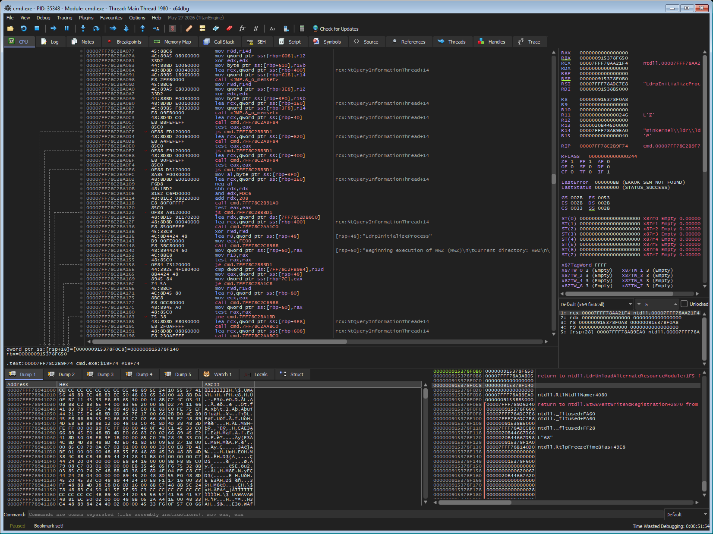
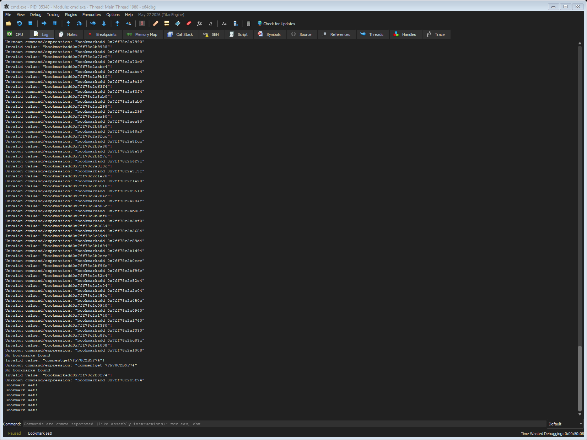

# The headless GhydraMCP

The plugin serves the REST API from a window a human is looking at. A headless Ghidra run serves
the very same API with nobody watching: the binary is imported, analysed, and the API answers for
that analysis.

It is not a second implementation. The headless run starts the same server, registers the same
twenty-one resources and uses the same decompiler service. What is behind them is what differs:
one fixed program and one fixed project, instead of a ProgramManager, a tool and a UI.

```
ghydra headless start C:\bin\cmd.exe      # analyse and serve, on port 8192
ghydra headless status                    # what is running
ghydra headless stop                      # end it; the analysis is saved first
```

The run outlives the command that started it: the state lives under `~/.ghidra`, so another command
— or the MCP bridge, which discovers the instance on its own — finds it later.

---

## The commands

### `ghydra doctor`

Before anything: is this machine ready? The installation, the JDK it needs, the extension and the
version it was built for, the port, the project directory, the API, Kuna and the x64dbg plugin.
Every problem comes with the command that solves it.

```
ghydra doctor
```

The JDK is the part that bites. Ghidra 11.x wants a JDK 21 and Ghidra 12.2 wants a JDK 25, and the
installation's own VM arguments carry flags that only the newer JVMs take - so a run with the wrong
one dies with a message about a flag instead of about the JDK. The doctor finds the installation
first and asks about the JDK in terms of *that* installation.

The paths of Ghidra and of the JDK can be written down in `~/.ghydra/config.json`:

```json
{
  "ghidra_home": "C:\\tools\\ghidra",
  "java_home": "C:\\tools\\jdk-25"
}
```

### `ghydra inspect <target>`

What is this target, and what does it need? The format comes from the bytes and never from the name
of the file. It needs neither Ghidra nor the network.

```
ghydra inspect C:\bin\cmd.exe
```

### `ghydra headless start <binary>`

| Option | What it is |
| --- | --- |
| `--port`, `-p` | the port to serve on (default: 8192) |
| `--project-dir` | where the Ghidra project lives (default: `~/ghidra_projects`) |
| `--project-name` | the name of the project (default: the name of the binary, with a mark of its path) |
| `--ghidra-home` | the Ghidra installation (default: `GHIDRA_HOME`) |
| `--java-home` | the JDK (default: `JAVA_HOME`) |
| `--timeout` | how long to wait for the API, in seconds (default: 900) |

The command waits for the API to answer before it returns, so a script can use it as a gate: the
next command talks to an instance that is up.

### Native Ghidra Server repository workers

Run these commands **out of band under the isolated POSIX worker account** that owns the
private connection store, not under the agent's account. Provision an approved `ghidra`
profile using [worker connection setup](GHYDRA_CONNECTIONS.md) first. The native repository
must already exist; this mode never imports a local binary or creates a repository.

```sh
ghydra headless start --repository-profile team-repository \
  --program folder/program.exe --connections-dir /srv/ghydra-worker/connections
ghydra headless status --port 8192
ghydra headless stop --port 8192
```

`--program` selects exactly one existing program relative to the profile's approved repository
folder. An optional leading `/` is accepted; traversal, empty components, wildcard patterns,
control characters, encoded paths and native option names are refused. Do not supply a binary,
`--project-dir` or `--project-name` in repository mode. The directory may instead be selected
by `GHYDRA_CONNECTIONS_DIR` (a path only, never credentials).

The normal detached native JVM lifecycle starts a **persistent empty local project**, with no
`-import`, `-process`, native repository URL, `-connect`, `-p`, `-keystore` or native `-commit`
arguments. The bootstrap project lives under `~/ghidra_projects/repository-workers`; its stable
name identifies the opaque profile and literal program path, not a local binary. It is not
imported-binary provenance or evidence that a repository program was saved.

The only connection JVM property is `-Dghydra.connections.dir`, an operator-supplied directory
path. Python never opens the private profile/credential store and never supplies authentication
through argv, environment or stdin. Java's isolated credential worker alone reads credentials,
inside the approved scope of the repository HTTP operation. The profile ID and program path
travel through the existing `/repositories` APIs after the local HTTP server is ready. No
initial native-analyzer authentication or Python authentication supervisor exists. Worker
scripting routes remain disabled; arbitrary native arguments and scripts are not accepted.

Startup browses the selected program's parent folder through offset pages until the exact file
is found. Read-only mode explicitly opens its **positive latest repository version**, obtaining
an immutable snapshot even when the worker already has a writable local checkout.

Writes require the `read`, `checkout` and `checkin` profile grants, plus both explicit options:

```sh
ghydra headless start --repository-profile team-repository --program folder/program.exe \
  --connections-dir /srv/ghydra-worker/connections \
  --writable --commit 'Reviewed analysis changes'
```

Writable startup reuses only a current exclusive local checkout. Otherwise it requests an
exclusive checkout before opening the latest writable program. Existing nonexclusive/stale
checkouts and server conflicts are refused, never overridden or merged automatically.

**Save and check-in are separate operations.** Before normal stop, `/program/save` persists the
active workspace locally. Only writable mode then explicitly checks in the original approved
profile/program, with the operator's comment. This uses `keep_checked_out=true`: Ghidra cannot
release the checkout while the native program remains open. The **exclusive checkout persists
after stop**; arrange its release separately after closing programs, using the native repository
workflow. Save alone never publishes a repository version.

Stop reports independent `saved` and `checked_in` fields from the actual HTTP results, never
native output matching, analyzer exit status, or bootstrap-project writes. `saved=false` with
“no unsaved changes” is a valid unchanged workspace. `null` means no confirmation was received,
not an invented success or failure; `confirmation_unknown` exposes that distinction. Refused or
unconfirmed save/check-in leaves the worker and state available rather than discarding work.

Before every writable check-in, the original file's metadata is read afresh.
An unchanged checkout stops without publishing a version (`checked_in=false` if
none was published during this run). A prior confirmed check-in is retained only
when `modified_since_checkout=false`; edits saved separately through HTTP require
another explicit check-in. Missing change-state confirmation refuses stop.

Named sessions use the same options and retain the remote profile/program selection:

```sh
ghydra session open --repository-profile team-repository --program folder/program.exe \
  --connections-dir /srv/ghydra-worker/connections --name review
ghydra session close SESSION_ID
ghydra session reopen SESSION_ID --connections-dir /srv/ghydra-worker/connections
```

Reopening a stopped session starts the same profile/program context, with Java resolving current
approved credentials, including rotations. Stop reattaches from retained PID/port/profile/program
metadata without Python credential reads. Save/check-in failures and shutdown refusals preserve
the running session. Normal stop timeouts retain the worker and state and send **no termination
signal**; only cleanup of an owned child whose startup failed may force termination.


### `ghydra headless status`

What is on the port: whether the run is alive, whether the API answers, the program it serves, the
project, the log and the pid.

### `ghydra headless stop`

Ends the run. The program is saved first, so the project holds the analysis and the program can be
opened in Ghidra later. The answer says whether the analysis is in the project, and a save the
server refused is not reported as a save.

**The serving script releases its own transaction before starting the API.**
This permits explicit signature/type application to use an independent atomic
transaction. It does not end unrelated transactions; those can still prevent an
operation or save. On normal stop the analyzer also saves its program when the
script returns. The project database under `<project>.rep/idata/` remains the
on-disk witness used by the launcher, not an assumed success from a save request.

The stop takes about a second. The script stops the server it started, the analyzer saves the
program and closes the project, and the process exits. The server has to be stopped: the threads of
a Jetty are not daemons, and a JVM with a live Jetty does not exit. If shutdown is refused or
times out, the launcher retains the process and state; it does not force-kill a managed selection.

The state of the run is erased only while it is still that run's state. A start that was refused
before the analyzer was launched has no process of its own, and the state on disk belongs to a run
that is still there — erasing it would leave that run untracked, and the next start would walk past
the guard that remembers it.

---

## The launcher

The runner does not call Ghidra's launcher script. It builds the same JVM invocation the launcher
makes - the installation's own VM arguments, read from Ghidra's `LaunchSupport`, the headless heap
and thread flags, and the analyzer class - and that is what makes three things true:

* **the log of the run is the log that was asked for**, at `~/.ghidra/headless-<port>.log`, and not
  the one the Ghidra application log happens to hold;
* **the Windows launcher does not ask "press any key to continue"** when it fails: it cannot tell a
  double-click from a shell, and a launcher that was started by another program is exactly that
  case;
* **the JDK is found by asking Ghidra which one it supports**, instead of trusting `JAVA_HOME`.

The JDK is versioned against the installation: `application.java.min` says which one the Ghidra
needs, and a JDK that is too old is not used. The layers, in the order of how explicit the decision
is: what the caller asked for, what `~/.ghydra/config.json` says, `JAVA_HOME`, the JDK Ghidra
itself would use, and the places a JDK is usually installed.

### The evidence ledger and the sessions

A finding used to live in the analyst's head and die with the session. `ghydra evidence` gives every
finding an ID that never changes, and `ghydra session` keeps a named working context alive across
shells. Both are described in [GHYDRA_CLI.md](GHYDRA_CLI.md).

## Where things live

**The installation.** `GHIDRA_HOME` points at it; without it the launcher looks in the places
Ghidra is usually installed — `%LOCALAPPDATA%\Programs\Ghidra`, `%ProgramFiles%\Ghidra`,
`~/scoop/apps/ghidra/current` on Windows, and `/opt/ghidra`, `/usr/local/ghidra`,
`~/ghidra` on Linux and macOS.

**The launcher.** `support/analyzeHeadless` on POSIX and `support/analyzeHeadless.bat` on Windows.
The JDK comes from `JAVA_HOME`; Ghidra 12 needs a JDK 21 or newer, and the machine's default is
often an older one, so `--java-home` is there for that.

**The project.** `ghidra_projects` in your home directory — Ghidra's own convention. Not
`~/.ghidra`: **Ghidra refuses a project path with an element that starts with a dot** ("Path
element starting with '.' is not permitted"), and `.ghidra` is exactly that. The launcher says so
when the path it is given is refused.

Its name is the name of the binary with a mark of where the binary came from — `cmd-3f2a1b9c` for
`C:\Windows\System32\cmd.exe`. Ghidra identifies a program by its file name, so two binaries with
the same name in different directories are two programs that cannot live in the same project; the
mark is what keeps them apart, so the second one is imported instead of being served the analysis
of the first. `--project-name` names the project yourself.

**The state.** `~/.ghidra/headless-<port>.json` remembers the run, and `~/.ghidra/headless-<port>.log`
holds its output. The log is where the reasons a run failed are.

The state carries two things besides the run itself. The port is **claimed** before the analyzer
is launched, so two starts that arrive together cannot both find the port free and launch an
analyzer each — the one that binds the API first would answer both waits, and the report could
combine the Ghidra data of one binary with the Kuna data of another. The claim carries a **token**
that says which launcher made it, and a claim that no run took up is given back after a minute, so
a launcher that died does not hold the port forever. A start that finds the port claimed says so.

The PID that the state remembers is checked against the port as well as against the marker of the
script: the PID of a run that crashed is reused by another run of the same script — on another
port, with another project — and stopping that one would kill a live analysis.

---

## Import or process

A program that is already in the project is processed again; one that is not is imported. Importing
a program that is already there fails, and the run never reaches the script that starts the server —
so the launcher reads the index of the project to tell the two apart.

The index of a Ghidra project is plain text, one line per file:

```
VERSION=1
/
 00000000:cmd.exe:a9fe536bff6c5085139269700
NEXT-ID:1
```

---

## The report

```
ghydra report build C:\bin\cmd.exe --output out
```

Three files come out:

| File | What it is |
| --- | --- |
| `cmd-report.md` | the report a human reads |
| `cmd-report.json` | the same, machine-readable |
| `cmd-x64dbg.json` | the annotations, for the debugger |

**Ghidra and Kuna, side by side.** The report holds the program, its functions, its imports, its
exports, its strings and its segments as Ghidra sees them, next to the C that Kuna recovered. The
two are matched **by address**: both tools read the same binary at the same addresses, so the
functions Ghidra found and the functions Kuna found can be put next to each other without any
conversion.

**The functions worth a look.** Three groups, in this order: the ones Kuna found big (the size is
in its index, and it is the only one of the two tools that measures it), the ones Ghidra found with
a name of their own, and the entry point. The top of the report is the decompilation of the first
of them.

**The options.** `--no-kuna` leaves Kuna out, `--no-headless` uses the instance that is already
there instead of starting one, `--keep` leaves the headless run running when the report is done,
and `--max-functions`, `--max-strings`, `--max-decompile` and `--max-annotations` say how much of
each to read.

---

## The annotations

The report writes the annotations with the image base, so the debugger can translate them into the
addresses of the live process:

```
ghydra x64dbg annotate cmd-x64dbg.json --bookmarks
```

Every function becomes a comment — the signature, the size, what Kuna called it — and, with
`--bookmarks`, a bookmark. `--mode Label` sets labels instead of comments.

The translation is `runtime = static − image_base + module_base`, the same model the `ghydra
x64dbg breakpoint` and `ghydra x64dbg go-to` commands use. The module is the one that matches the
binary of the report; the plugin's own module list is what says where the loader put it.



**A note on the bookmarks.** The x64dbg plugin's own `SetBookmark` runs `bookmarkadd`, which is
not an x64dbg command: the log answers "Unknown command" and the plugin still reports "Bookmark
set.". x64dbg's commands are `bookmarkset` (alias `bookmark`), `bookmarkdel` and `bookmarklist`,
so the annotation flow runs `bookmarkset` directly.



**A note on the retries.** A local TCP connection is reset every now and then on some machines
(measured: 7% of the connections). Setting a comment and setting a bookmark are the same operation
twice over, so the annotation flow repeats what failed. Against the real debugger, three of sixty
annotations failed on the first pass and all sixty were set on the second.

---

## The dynamic half

```
ghydra x64dbg report --output out
```

What the debugger is doing right now: the state, the registers, the modules with their bases, the
breakpoints, the disassembly at the instruction pointer, the call stack and the memory map — as a
Markdown document and a JSON file. It needs no Ghidra.

---

## What the headless run does not have

The endpoints that need the GUI's cursor — `/address` and `/function` — answer `503` with
`HEADLESS_LIMITATION` in a headless run. There is no cursor without a window, and pretending
otherwise would be worse than saying so. The test suites that exercise them need the CodeBrowser;
every other endpoint behaves the same in both.

The debugger is a different matter: the x64dbg plugin drives it without a human, but the debugger
is a program with a window, and there is no build of it that runs without one. The headless part
of this document is about Ghidra.

---

## The script that starts the server

The headless run is Ghidra's own `analyzeHeadless`, with one extra script:

```
analyzeHeadless <project-dir> <project-name> \
    -import <binary> -postScript GhidraHeadlessServer port=8192
```

The script lives in the extension (`ghidra_scripts/`), so the server it starts is the same server
the CodeBrowser plugin starts. It stays in the run for as long as the server is wanted: the
headless analyzer waits for the script to return, and it only returns when the launcher asks for
it.

**A script has to import the class it extends.** `GhidraScript` is not in the default package, and
Ghidra only adds the import to the template it writes for a *new* script. An existing one has to
carry it:

```java
import ghidra.app.script.GhidraScript;

public class GhidraHeadlessServer extends GhidraScript {
```

Without it the script does not compile, and the error says nothing about the import: "cannot find
symbol" on the class, and on everything the class brings with it (`currentProgram`, `state`,
`getScriptArgs()`). It was measured: the same failure happens for a script inside a Ghidra module
and for one outside every module, so it is not about where the script lives.

**Stopping the run.** The launcher leaves a stop file in `GHYDRA_STATE_DIR`, or
`~/.ghidra/headless-<port>.stop` when no state directory is set, and
the script returns when it sees it. The headless analyzer then saves the program and closes the
project, and the project is left unlocked. Killing the process instead leaves the lock file
behind, and the next run refuses to open the project.

---

## Building without Maven

The extension needs a JDK and the Ghidra jars; the Maven build shades Javalin, Jetty, SLF4J and
Kotlin into `Ghydra.jar`. On a machine that has a JDK and no Maven:

```
python scripts/make_uberjar.py target/classes target/lib lib/Ghydra.jar
```

The script merges the compiled classes and the runtime dependencies into one jar, the way the
Maven build does. The script that starts the server is not in the jar: it is a file of the
extension, in `ghidra_scripts/`.
